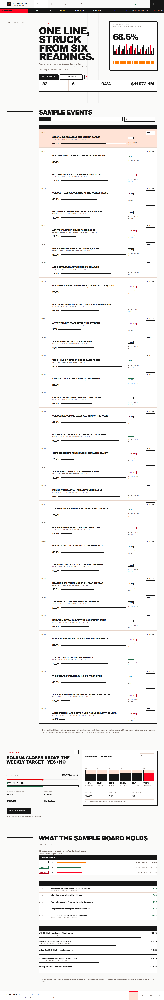
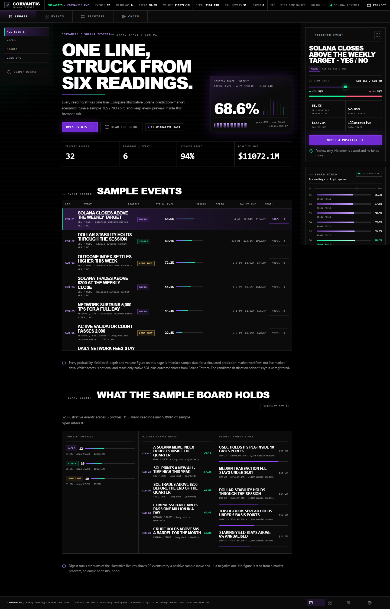
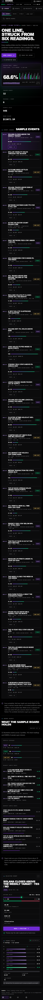
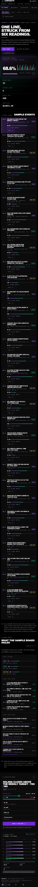

# Reskin report — Corvantis

Generated: 2026-10-21 (Asia/Shanghai)

## Art direction

| Field | Value |
|---|---|
| Style | **Spectrum Terminal** (`solana-spectrum`, performance-brutalist) |
| Source DNA | [https://solana.com](https://solana.com) — live sampled (3 927 ms, HTTP 200) |
| Live vs fallback | **Live**: 9/10 blockchain references answered; the selector scored every direction against the original accent (`#ff0421`) and background (`#fafaf9`) |
| Original | `marketing-stack` / editorial / accent `#ff0421` |
| Accent distance | `#ff0421` → `#9945ff` = **135.92 ΔE** (minimum 30) |
| Palette | ground `#000000`, panel `#0B0B0C`, raised `#161618`, ink `#FFFFFF`, muted `#9B9B9F`, rule `#29292D`, signal `#9945FF`, trace `#14F195`, YES `#14F195`, NO `#FF5C7A`, caution `#FFD166` |

Only abstract DNA was taken from the reference: black ground, violet signal with a
phosphor-green secondary, narrow uppercase display type, monospaced data,
hairline rules, scanline grain, compact density and 120 ms eased motion. No logo,
image, copy or code from any reference site is used. The brand, mint, routes and
copy are the project's own.

## Skeleton

**Terminal Console** → implemented as a dense three-pane console:

- a **status bar** carries the wordmark, the desk telemetry strip, the cluster LED
  and the wallet chip; a **command bar** carries the four route commands;
- the work area is a **grid of filter rail | view | inspector**; the filter rail
  holds the profile segment and search (plus sort on Events), the view holds the
  route's content, and the inspector is a sticky rail with the selected event and
  the shard field;
- the Overview readout is a compact kicker + statement + lede + actions beside a
  session-trace telemetry panel, followed by four KPI cells, a ruled event ledger
  and a three-slab digest;
- receipts are stacked console receipts, and Chain is a two-panel fact/matrix
  block;
- below 980 px the three panes collapse to one column with the filter rail as a
  horizontal strip, and the inspector follows the view.

### Skeleton deviation, and why

`choose-style.mjs` proposed **Ticker Stage** for the detected `marketing-stack`
original. The live shell being replaced *is already a ticker/broadcast stage*
(the previous cycle's poster desk: sticky masthead, horizontal ticker ribbon,
full-width horizontal beats, ruled ledger bands). The inventory's keyword
classifier labels it `marketing-stack` because frozen copy contains "panel" and a
fixture comment contains "hero". Rebuilding Ticker Stage would reproduce the
current skeleton and fail the "visibly different skeleton" requirement and the
DOM-similarity gate. The same catalogue's **Terminal Console** was used instead:
same `linear` family, same Spectrum Terminal DNA, and the documented fix for a
"too similar" skeleton. The art direction itself was not substituted.

Diff vs the original shell, as measured by the verifier:

| Signal | Baseline | Current | Gate |
|---|---|---|---|
| Detected archetype / family | `marketing-stack` / editorial | `sidebar-workspace` / shell | changed ✓ |
| Sidebar / terminal / ticker traits | false / false / **true** | **true** / **true** / false | changed ✓ |
| Landmark sequence similarity | — | 0.556 | ≤ 0.68 ✓ |
| DOM fingerprint similarity | — | 0.380 | ≤ 0.50 ✓ |
| Rendered CSS class overlap | — | 0.008 | ≤ 0.10 ✓ |

## Screenshots

| View | Baseline (poster ticker) | Current (terminal console) |
|---|---|---|
| Desktop 1440×900 |  |  |
| Mobile 390×844 |  |  |

The baseline is cream, poster-sized and horizontally banded with a ticker ribbon
and no rail; the current is black, console-dense, split into a filter rail, a view
and an inspector, with a status bar and a command bar. The two are not readable as
the same shell at a glance: the accent family, the card/rule silhouettes, the
navigation pattern and the page composition all differ.

## Verification

```
node <reskin>/scripts/verify.mjs check --project <repo>/website --out .reskin
PASS — 1 route(s), content intact, skeleton replaced, usability clean.
```

**Verdict: PASS** (`.reskin/VERIFICATION.md`, `.reskin/verification.json`).

| Gate | Result |
|---|---|
| Source content contract | intact — 0 issues, 0 warnings |
| Content-contract hash | baseline `00fc81c53494…` → current `00fc81c53494…` (identical) |
| Rendered words `/` | 530 — 0 missing, 0 extra |
| Rendered numeric tokens | 105 distinct / 144 total on both sides |
| Rendered attributes | 0 missing, 0 extra |
| Form fields | identical |
| Document title | `Ledger | Corvantis` unchanged |
| Routes | `/` (single-page hash app); no route added |
| Console / page errors | 0 |
| Contrast | **0** failures in 444 checks |
| axe WCAG 2.0/2.1/2.2 A+AA | **0** violations (serious, moderate) |
| Horizontal overflow | none at 1440 and at 390 |
| Labels / accessible names / alt | 0 issues |
| Keyboard focus | visible indicator on every sampled stop |
| Mobile navigation | reachable, same targets as baseline |
| Build | passes (`vite build`) |

No warnings.

## Files

Replaced in place:

- `website/src/style.css` — new design system on the Spectrum Terminal tokens.
  New class namespace (`st-*`), new token names (`--bg`, `--surface`, `--accent`,
  `--accent-fill`, `--accent-safe`, `--accent-2`, `--line-strong`, `--bar-h`,
  `--cmd-h` …). No `brd-*` selector and no poster token survives.
- `website/src/App.vue` — template rebuilt around the status bar, command bar,
  three-pane work grid, readout, KPI cells, ledger, digest, inspector and footer.
  `<script setup>` is unchanged except the component imports, plus two
  presentational computeds (`showFilters`, `showDetail`).
- `website/index.html` — `color-scheme` and `theme-color` follow the dark palette;
  title, description, Open Graph metadata, icon links and `lang` are unchanged.
- `website/a7104sol/**` — mirror re-synchronised (`scripts/sync-frontend.ps1`),
  both projects build and `scripts/verify-delivery.py` passes.

New components:

- `src/components/SpectrumBar.vue`, `CommandNav.vue`, `ConsoleFoot.vue`,
  `EventGrid.vue`, `EventInspector.vue`, `ShardMeter.vue`, `ReceiptList.vue`,
  `ChainPanel.vue`, `Glyph.vue`, `SignalToast.vue`.

Removed from the render path (sources kept byte-for-byte in
`.reskin/original-src/`):

- `src/components/{BroadcastBar,TickerBand,RouteRoll,EventLedger,EventBeat,FieldBeat,ReceiptLedger,ChainLedger,FlowIcon,Toast}.vue`
  — every text token they rendered now lives in the new components above.

No application logic was touched: `src/config.js`, `src/data/fixtures.js`,
`src/composables/useWallet.js`, `src/main.js`, `src/polyfills.js`,
`vite.config.js`, `package.json`, the tests and the deployed mint record are
unchanged.

## Accessibility and responsive results

- One `h1` per route. Overview's `h1` is the statement; Events, Receipts and Chain
  each have their own. Semantic `header`, `nav`, `main`, `aside`, `footer`.
- The profile segment is a named `group` with `aria-pressed`; every ledger row
  exposes a `role="button"` target with `tabindex="0"`, `aria-pressed` and the
  original accessible name, and `Model` is a sibling button (no nested
  interactive controls).
- The telemetry strip and command bar scroll natively; both remain reachable by
  keyboard. Focus indicators are visible on all controls.
- Body copy is `#9B9B9F` on `#000000` (8.1:1) and `#FFFFFF` on `#000000`
  (21:1); `--accent-safe` `#C6A2FF` is used for accent text (9.9:1) while
  `--accent` fills buttons only behind white text on `#6F2BD1` (7.4:1).
- Responsive: 1180 px narrows the inspector; 980 px collapses to one column with
  the filter rail as a horizontal strip and the inspector below the view; 720 px
  stacks the header telemetry, keeps the command bar scrollable and turns ledger
  rows into a ref + stack layout; 430 px stacks KPI and fact grids. Nothing is
  hidden to make this work.
- `prefers-reduced-motion: reduce` disables transitions and smooth scrolling.

## Twitter materials

The media kit (`twitter/rebrand_assets.py`) was regenerated from the same
`twitter/brand.json` palette after the reskin, so the avatar, banner, launch and
CA cards, practice and testnet guides, manifesto card and the Open Graph card all
belong to the shipped interface: black ground, violet signal, phosphor trace,
shard-forge mark. The kit ships in `twitter/`, `website/public-active/` and the
review sheets in `output/corvantis/`. This was the second generation in the cycle:
the first ran before the reskin, the second after it (the `.rebrand` documents
record the palette change).

## Known limitations

- The app is a hash-routed single page, so the verifier captures `/` (Ledger) for
  its structural, contrast and axe gates. Events, Receipts and Chain share the
  same console, filter rail and inspector and were reviewed through the
  post-reskin rebrand capture in `.rebrand/screenshots/`.
- The Overview ledger scrolls inside a fixed-height console body (as the previous
  ledger rail did), so the full 32-row ledger is reachable by scroll rather than
  printed in one very tall page. No row is hidden.
- The footer navigation labels are revealed on hover/focus, preserving the same
  information pattern as the previous footer index; the command bar above it is
  always labelled.
- The Open Graph description in `index.html` is frozen metadata and still reads
  "A pale ledger workspace …"; it was not rewritten because the content contract
  treats metadata as immutable.
- `.reskin/` artifacts (baseline, current, verification, wireframe, report,
  original sources) are ignored by the app build and by the inventory scan.

## Repository delivery checks

```
cd website && npm test && npm run build            # 12/12 tests, build OK
cd website/a7104sol && npm run build               # build OK
powershell -File scripts/sync-frontend.ps1
python scripts/verify-delivery.py                  # "Corvantis Testnet delivery checks passed …"
```

> The UI was rebuilt around **Spectrum Terminal / Terminal Console**; the original
> **marketing-stack** shell and palette were removed while the content contract
> stayed byte-for-byte intact.
